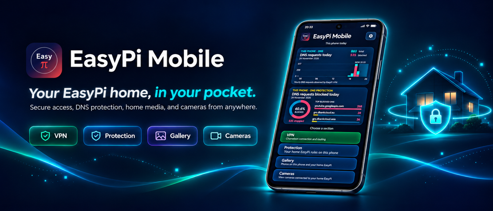
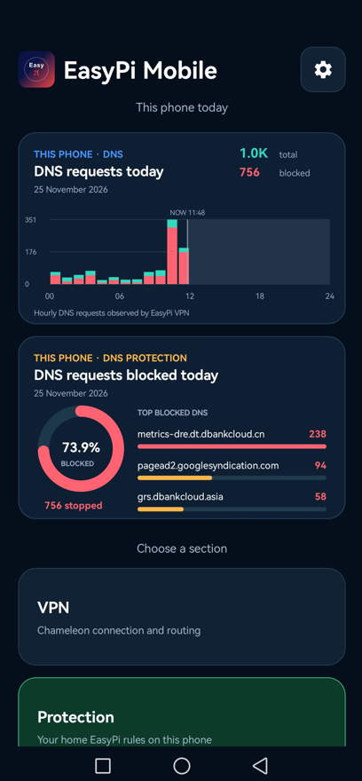
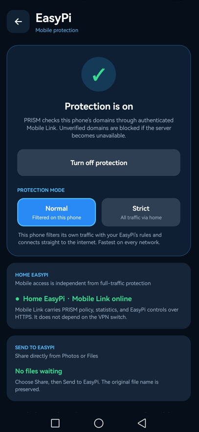
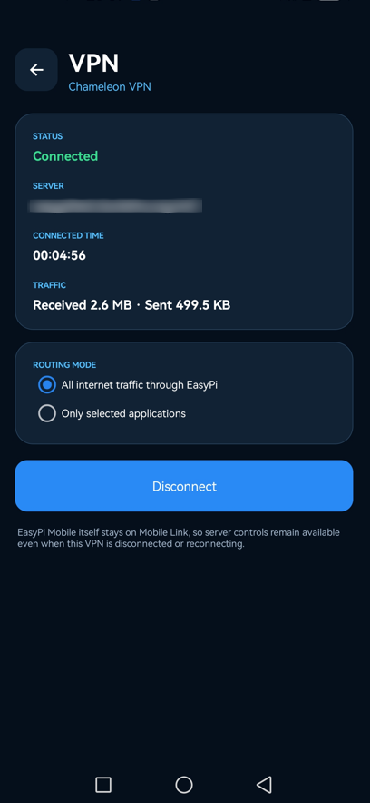
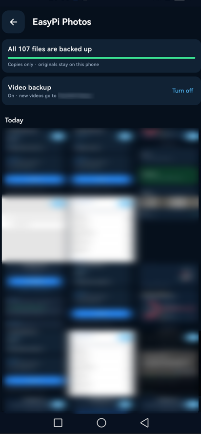
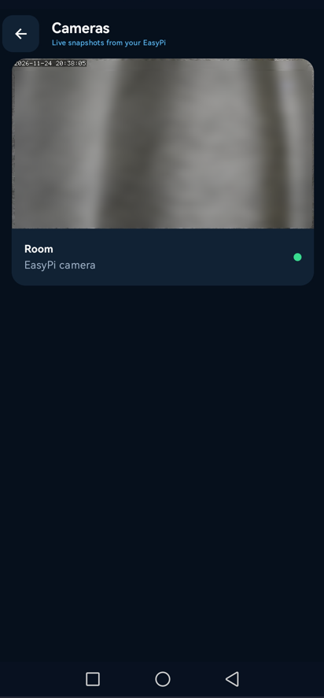
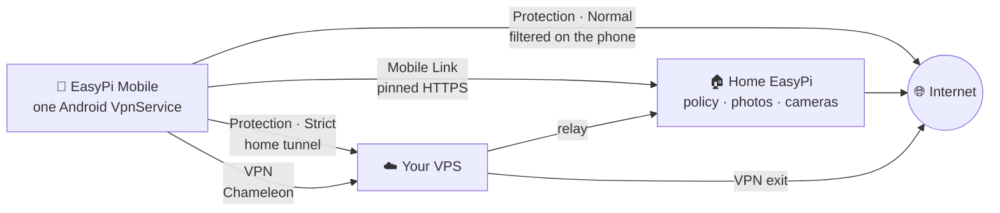

<p align="center">
  
</p>

<p align="center">
  
  
  
</p>

---

EasyPi Mobile is the Android companion app for an
[EasyPi](https://github.com/NewNetGuard/EasyPi) home server. Pair the phone
once with your home EasyPi, and it carries your home network's protection,
parental controls, photos and cameras wherever you go — on home Wi-Fi, mobile
data or someone else's network.

## Screenshots

<table>
  <tr>
    <td align="center" width="20%"><br><sub>Home</sub></td>
    <td align="center" width="20%"><br><sub>Protection</sub></td>
    <td align="center" width="20%"><br><sub>VPN</sub></td>
    <td align="center" width="20%"><br><sub>Gallery</sub></td>
    <td align="center" width="20%"><br><sub>Cameras</sub></td>
  </tr>
</table>

## Features

| | Section | What it does |
|---|---|---|
| 🛡️ | **VPN** | An encrypted Chameleon tunnel to your own VPS. Built to stay unobtrusive on networks that inspect traffic. Uses the VPS's IPv6 address when it has one and falls back to IPv4 automatically. |
| 🔒 | **Protection** | Applies your home EasyPi's filtering policy on the phone: blocklists, parental controls, schedules and blocked services. Two modes, described below. |
| 🖼️ | **Gallery** | Backs up copies of your photos and videos to your home EasyPi (originals stay on the phone) and lets you browse EasyPi Photos. Any app can send files to EasyPi with **Share → EasyPi**. |
| 📷 | **Cameras** | Live snapshots from the cameras connected to your home EasyPi. |
| 📊 | **Dashboard** | Today's DNS requests and blocks per hour, the block rate and the most-blocked domains. |

### Protection modes

The Protection screen shows the two modes as explicit buttons. You can switch
at any time, even while Protection is running.

| Mode | How traffic flows | Best for |
|---|---|---|
| **Normal** — *Filtered on this phone* | The phone checks every domain against your home EasyPi's full policy, then sends allowed traffic straight to the internet. | Everyday use: full speed, with parental controls everywhere. |
| **Strict** — *All traffic via home* | All traffic is carried through an encrypted tunnel to your home EasyPi and leaves from your home connection. | Untrusted networks, or when traffic should appear to come from home. |

Policy changes made on the home EasyPi take effect within seconds in both
modes. In Strict mode EasyPi enforces them directly. In Normal mode the phone
caches decisions briefly, drops the cache as soon as the home policy changes,
and blocks a request when it cannot get a decision instead of letting it
through.

VPN and Protection are independent switches. Each works on its own, and they
can run together: Protection then filters on the phone and traffic leaves
through the VPN. The Strict choice applies again once the VPN is off.

## How it works



- **One VPN service.** Android allows a single `VpnService`, so Protection and
  VPN share one TUN interface. The EasyPi app itself is excluded from the
  tunnel, so the management link stays available while the VPN reconnects.
- **Mobile Link.** Policy, photos, cameras and statistics use an authenticated
  HTTPS API on the home EasyPi, with the server's certificate pinned during
  pairing.
- **Home tunnel (Strict).** The tunnel is relayed through your VPS, so the home
  router needs no open ports. On a verified home network the phone connects to
  EasyPi directly over the LAN for full local speed.
- **No leaks.** While the VPN or the Strict tunnel is on, IPv6 traffic cannot
  bypass the tunnel.

## Security and privacy

- Pairing works by scanning a QR code shown in **Mobile Assistant** on the home
  EasyPi. Each phone receives its own restricted credentials. Deleting the
  device on EasyPi revokes its access immediately.
- The Mobile token and the VPN profile are encrypted with the Android Keystore.
- No root, no Accessibility service and no screen reading. Filtering works on
  DNS names and TLS server names, so the content of your traffic is never
  decrypted.
- Release APKs are signed only with an external production key that never
  enters the source tree.

See [SECURITY.md](SECURITY.md) for details.

## Requirements

- An Android 11 (API 30) or newer phone with a 64-bit ARM processor
  (`arm64-v8a`).
- A home [EasyPi](https://github.com/NewNetGuard/EasyPi) server with Mobile
  Assistant enabled.
- For the VPN and for Strict Protection away from home: a VPS set up from
  EasyPi's Stealth section.

## Building from source

**Prerequisites:**
- JDK 17, with `JAVA_HOME` set.
- The Android SDK (API 36) and the Android NDK.
- Go. The build script pins the Go 1.27.4 toolchain and the matching gomobile
  version itself.
- The EasyPi repository checked out next to this one, so that
  `..\EasyPi\chameleon` exists. You can pass another path with
  `-ChameleonSourceRoot`.

1. Build the native library, which contains the PRISM filter, the Protection
   engine, the home tunnel and the Chameleon client in one Go runtime:

   ```powershell
   .\Build-Libtailscale.ps1
   ```

2. Run the unit tests and build the app:

   ```powershell
   .\gradlew.bat testDebugUnitTest assembleRelease
   ```

3. For a signed production release, run:

   ```powershell
   .\Build-SecureRelease.ps1
   ```

   The script needs a signing configuration stored outside the repository, by
   default `%USERPROFILE%\.android\easypi-mobile-signing\signing.json`. It writes
   `app\build\outputs\apk\release\EasyPi-Mobile.apk` and its SHA-256 checksum,
   `EasyPi-Mobile.apk.sha256`.

Release builds target `arm64-v8a` only, to avoid packaging the Go runtime four
times. For an x86_64 emulator, pass `-PeasypiAbis=x86_64`.

## Documentation

- [EasyPi Protection Engine](docs/EASYPI_PROTECTION_ENGINE.md): the data path
  of Normal Protection.
- [No root required](docs/NON_ROOT_MOBILE.md): what the ordinary app does and
  does not do.
- [Security build and operation](SECURITY.md).

## License

EasyPi Mobile is **source available**, not OSI open source. It is distributed
under the [EasyPi Source Available License 1.3](LICENSE), the same license as
EasyPi. It permits you to inspect and audit the code, build it for personal
non-commercial use, and modify it privately. Commercial use and independent
redistribution require prior written permission. The embedded Chameleon client
comes from EasyPi's `chameleon/` directory and keeps its own license.

See also the [EULA](EULA.txt) and the
[third-party licenses](THIRD_PARTY_LICENSES.md).
